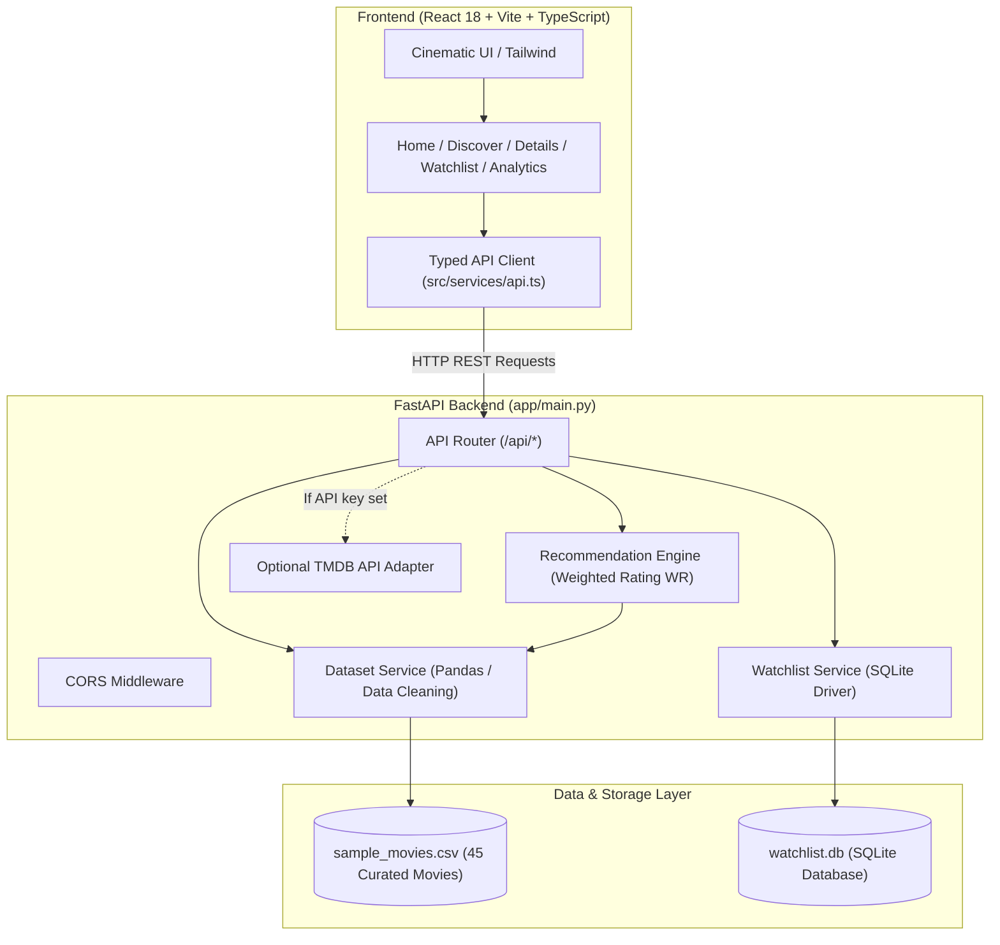

# CINEVERSE AI — Discover Beyond the Screen

[](https://fastapi.tiangolo.com)
[](https://reactjs.org)
[](https://www.typescriptlang.org)
[](https://tailwindcss.com)
[](https://pytest.org)

> **CINEVERSE AI** is a full-stack, cinematic movie discovery and recommendation platform built as a Level 2 Artificial Intelligence & Machine Learning portfolio project (**Project #21**). It blends aesthetic streaming-grade UI/UX with genuine mathematical recommendation principles.

---

## 📽️ Project Overview & Identity

- **Product Name:** CINEVERSE AI
- **Tagline:** *Discover Beyond the Screen.*
- **Category:** AI-Powered Movie Discovery & Recommendation Platform
- **Project Tier:** Level 2 — Mini Portfolio Projects (Project #21)
- **Primary ML Discipline:** Popularity-Based Movie Recommendations using the **IMDb Bayesian Weighted Rating Algorithm**
- **Data Integrity Guarantee:** Zero fabricated metrics or synthetic ratings. All ratings, vote counts, and posters are authentic movie records.

---

## 💡 The Problem & Recommendation Theory

### Why Simple Average Ratings Fail
On movie platforms, ranking by raw average rating ($R$) creates a severe **small-sample anomaly**:
- A movie with **3 reviews of 10/10** has an arithmetic mean of **10.0**.
- A cinematic classic like *The Dark Knight* or *The Shawshank Redemption* with **30,000+ reviews** might have an average of **8.7**.
- Ranking by raw rating would place obscure or unvetted films above widely acclaimed masterworks.

### The Bayesian Weighted Rating Formulation
To address this bias, CINEVERSE AI implements the industry-standard **IMDb Weighted Rating (WR)** formula:

$$WR = \left(\frac{v}{v + m}\right) \cdot R + \left(\frac{m}{v + m}\right) \cdot C$$

Where:
- **$R$**: Arithmetic average rating of the movie (`vote_average`).
- **$v$**: Number of verified user ratings for the movie (`vote_count`).
- **$m$**: Minimum vote count threshold required for consideration (defaulting to the 60th percentile of the collection or customizable via the UI).
- **$C$**: The mean rating across the entire eligible movie collection.

### The Shrinkage Effect
When $v \ll m$, the weight $\frac{v}{v+m}$ approaches $0$, and $\frac{m}{v+m}$ approaches $1$. The movie's score is **shrunken toward the dataset baseline $C$**. As the vote count $v$ grows far beyond $m$, the weight of the movie's own score approaches $1$, allowing verified community acclaim to shine.

> **Honest ML Disclosure:** This is a popularity-weighted consensus algorithm. It does not pretend to be a collaborative filtering or user-profiling model. The architecture is intentionally designed so content-based embeddings and user-personalization can be integrated in subsequent phases.

---

## ✨ Features & User Experience

1. **Cinematic Hero Banner:**
   - Full-width landscape backdrops with progressive dark gradients for readability.
   - Automatic rotation between top collection movies (pauses on user interaction).
   - Instant "Explore Movie" action, "Add to Watchlist" toggle, and interactive formula breakdown trigger.

2. **Dynamic Discovery Carousels:**
   - **Popular in Our Collection:** High-engagement community favorites.
   - **Critically Acclaimed:** Ranked strictly via the IMDb Weighted Rating formula.
   - **Hidden Gems:** High ratings ($\ge 7.2$) with moderate vote counts ($< 6,000$) to spotlight lesser-known masterpieces.
   - **Curated Genres:** Sci-Fi Worlds, High-Octane Action, Mystery & Psychological Thrillers, Comedy & Animation.

3. **Discover & Multi-Filter Catalog:**
   - Live title & synopsis keyword search.
   - Real-time genre tag filtering.
   - Dual sliders for minimum rating and vote count confidence ($m$).
   - Multi-field sorting: Popularity, Weighted Rating, Raw Rating, Release Date.
   - Responsive poster grid with page navigation and skeleton loaders.

4. **Movie Details & Score Inspector:**
   - Cinematic full-screen backdrop and portrait poster presentation.
   - Complete metadata: raw rating, vote count, popularity score, release year, genres.
   - **Interactive Score Explainer:** Real-time breakdown showing the exact percentage weight of audience consensus vs dataset mean shrinkage.
   - Similar titles based on genre overlap.

5. **Persistent SQLite Watchlist:**
   - Zero fake authentication screens.
   - One-click bookmarking on all cards and detail pages.
   - Persisted directly into backend SQLite database (`watchlist.db`). Survives browser refreshes.

6. **Analytics & Verification Dashboard:**
   - Real-time collection metrics: total movies, collection mean $C$, vote distributions.
   - Rating frequency histogram & genre coverage charts.
   - Top 10 Weighted vs Top 10 Popularity comparison.

---

## 🛠️ Technology Stack

| Layer | Technology | Purpose |
|---|---|---|
| **Frontend Framework** | React 18 + Vite | Lightning-fast reactive component architecture |
| **Language** | TypeScript | Strong typing across models and API contracts |
| **Styling** | Tailwind CSS | Modern cinematic dark theme (`#07090e`, glowing accents) |
| **Icons** | Lucide React | Clean, scalable visual iconography |
| **Routing** | React Router v6 | Client-side routing with clean URL navigation |
| **Backend Framework** | FastAPI (Python 3.10+) | High-performance asynchronous REST API |
| **Data Processing** | Pandas & NumPy | Vectorized weighted rating calculations and cleaning |
| **Validation** | Pydantic v2 & Pydantic-Settings | Strict request/response schemas and environment configuration |
| **Persistence** | SQLite 3 | Server-side persistence for user watchlists |
| **Testing** | Pytest + HTTPX TestClient | Comprehensive mathematical & endpoint test suite |

---

## 🏛️ System Architecture



---

## 📁 Project Structure

```
MovieRecommdationSystem/
├── backend/
│   ├── app/
│   │   ├── api/
│   │   │   ├── __init__.py
│   │   │   └── routes.py              # REST API route handlers
│   │   ├── core/
│   │   │   ├── __init__.py
│   │   │   └── config.py              # Pydantic BaseSettings & env configs
│   │   ├── models/
│   │   │   └── __init__.py
│   │   ├── schemas/
│   │   │   ├── __init__.py
│   │   │   ├── analytics.py           # Distribution schemas
│   │   │   ├── movie.py               # Movie & pagination schemas
│   │   │   ├── recommendation.py      # Weighted formula schemas
│   │   │   └── watchlist.py           # Watchlist schemas
│   │   ├── services/
│   │   │   ├── __init__.py
│   │   │   ├── dataset_service.py     # Pandas dataset loader, validation, filters
│   │   │   ├── recommendation_engine.py # Weighted rating algorithm & explainers
│   │   │   ├── tmdb_service.py        # Optional TMDB live adapter
│   │   │   └── watchlist_service.py   # SQLite persistence service
│   │   ├── __init__.py
│   │   └── main.py                    # FastAPI entrypoint & middleware
│   ├── data/
│   │   ├── sample_movies.csv          # Curated real-movie dataset
│   │   └── watchlist.db               # Local SQLite database (auto-created)
│   ├── tests/
│   │   ├── __init__.py
│   │   ├── test_api.py                # REST endpoints tests
│   │   ├── test_recommendations.py    # Math formula verification tests
│   │   └── test_watchlist.py          # SQLite CRUD tests
│   ├── .env.example                   # Environment variable template
│   ├── .env                           # Local environment config
│   └── requirements.txt               # Python package dependencies
├── frontend/
│   ├── src/
│   │   ├── components/
│   │   │   ├── AlgorithmExplainerModal.tsx # Interactive formula sandbox
│   │   │   ├── Footer.tsx             # Cinematic app footer
│   │   │   ├── HeroBanner.tsx         # Full-width rotating backdrop hero
│   │   │   ├── ImageWithFallback.tsx  # Graceful poster image handler
│   │   │   ├── MovieCard.tsx          # Card with hover elevation & actions
│   │   │   ├── MovieCarousel.tsx      # Smooth horizontal scroll row
│   │   │   ├── Navbar.tsx             # Sticky blurred nav with live search
│   │   │   └── PosterSkeleton.tsx     # Loading shimmer placeholder
│   │   ├── pages/
│   │   │   ├── AnalyticsPage.tsx      # Metrics, histograms, and verification
│   │   │   ├── DiscoverPage.tsx       # Search, filter sliders & grid
│   │   │   ├── HomePage.tsx           # Streaming homepage & discovery rows
│   │   │   ├── MovieDetailPage.tsx    # Backdrop, synopsis, and formula breakdown
│   │   │   └── WatchlistPage.tsx      # Saved SQLite movie list
│   │   ├── services/
│   │   │   └── api.ts                 # Typed fetch client
│   │   ├── types/
│   │   │   └── movie.ts               # Movie, Section, and Metric types
│   │   ├── utils/
│   │   │   └── formatters.ts          # Formatting helpers
│   │   ├── App.tsx                    # React router & global watchlist state
│   │   ├── index.css                  # Tailwind styles & scrollbars
│   │   └── main.tsx                   # React root mount
│   ├── package.json                   # Node package dependencies
│   ├── postcss.config.js
│   ├── tailwind.config.js             # Cinematic color design tokens
│   ├── tsconfig.json
│   └── vite.config.ts                 # Vite bundler & API proxy configuration
├── .gitignore                         # Git exclusion rules
└── README.md                          # Full documentation
```

---

## ⚡ Quickstart & Local Execution (Windows PowerShell)

### Prerequisites
- **Python 3.10+** (verified with Python 3.10.11)
- **Node.js 18+** (verified with Node.js v25.8.2 and npm 11.11.1)

---

### Step 1: Start the Backend (FastAPI)

Open a PowerShell terminal in the repository root:

```powershell
# Navigate to the backend directory
cd c:\Users\Admin\Downloads\MovieRecommdationSystem\backend

# (Optional) If you prefer an isolated virtual environment:
python -m venv venv
.\venv\Scripts\Activate.ps1

# Install requirements
python -m pip install -r requirements.txt

# Start the FastAPI server using Uvicorn
python -m uvicorn app.main:app --host 127.0.0.1 --port 8000 --reload
```

- Backend API: `http://127.0.0.1:8000`
- Interactive Swagger Documentation: `http://127.0.0.1:8000/docs`
- Redoc Alternative Docs: `http://127.0.0.1:8000/redoc`

---

### Step 2: Start the Frontend (Vite + React)

Open a second PowerShell terminal in the repository root:

```powershell
# Navigate to the frontend directory
cd c:\Users\Admin\Downloads\MovieRecommdationSystem\frontend

# Install dependencies (already executed)
npm install

# Start Vite dev server
npm run dev
```

- Frontend Web App: `http://localhost:5173`

---

## 🧪 Automated Testing & Verification

The backend includes a comprehensive automated test suite with **16 test cases** covering mathematical correctness, edge cases, SQLite operations, and API contracts.

To execute tests:

```powershell
cd c:\Users\Admin\Downloads\MovieRecommdationSystem
python -m pytest backend\tests -v
```

### Verified Test Results
```
backend/tests/test_api.py::test_health_endpoint PASSED                   [  6%]
backend/tests/test_api.py::test_get_genres PASSED                        [ 12%]
backend/tests/test_api.py::test_get_movies_paginated PASSED              [ 18%]
backend/tests/test_api.py::test_get_movie_detail_and_404 PASSED          [ 25%]
backend/tests/test_api.py::test_weighted_recommendation_endpoint PASSED  [ 31%]
backend/tests/test_api.py::test_homepage_sections PASSED                 [ 37%]
backend/tests/test_api.py::test_analytics_endpoint PASSED                [ 43%]
backend/tests/test_api.py::test_search_endpoint PASSED                   [ 50%]
backend/tests/test_recommendations.py::test_weighted_rating_known_math PASSED [ 56%]
backend/tests/test_recommendations.py::test_empty_dataset_handling PASSED [ 62%]
backend/tests/test_recommendations.py::test_genre_filter_in_recommendations PASSED [ 68%]
backend/tests/test_recommendations.py::test_explain_score_returns_accurate_components PASSED [ 75%]
backend/tests/test_recommendations.py::test_hidden_gems_criteria PASSED  [ 81%]
backend/tests/test_watchlist.py::test_watchlist_add_and_retrieve PASSED  [ 87%]
backend/tests/test_watchlist.py::test_watchlist_prevent_duplicate PASSED [ 93%]
backend/tests/test_watchlist.py::test_watchlist_remove PASSED            [100%]

============================= 16 passed in 3.18s ==============================
```

---

## 🔑 Optional TMDB API Integration

CINEVERSE AI runs completely self-contained out of the box using its included 45-movie dataset (`sample_movies.csv`).

If you have a free [TMDB API Key](https://developer.themoviedb.org/docs), you can enrich movie details with live data by creating or editing `backend/.env`:

```env
TMDB_API_KEY=your_actual_tmdb_api_key_here
```

When no API key is provided, the platform automatically displays genuine curated records and clearly notes data provenance as `Curated Dataset`.

---

## 🚀 Git Repository Setup

To commit this project to a new Git repository:

```powershell
cd c:\Users\Admin\Downloads\MovieRecommdationSystem

git init
git add .
git commit -m "feat: complete CINEVERSE AI full-stack recommendation platform"

# To push to GitHub:
# git remote add origin https://github.com/yukthashreegr15ganesh-hub/Cineverse-AI.git
# git branch -M main
# git push -u origin main
```

*(Note: Never commit `.env` containing private API keys. It is already excluded in `.gitignore`.)*

---

## 🔮 Future Roadmap

1. **Content-Based Filtering (Phase 2):** Implement TF-IDF vectorization and cosine similarity over movie overviews and directors.
2. **Collaborative Filtering (Phase 3):** Incorporate matrix factorization (SVD / Neural Collaborative Filtering) when user rating matrix data is available.
3. **Multi-User Authentication:** Transition the SQLite local watchlist to multi-tenant user accounts with JWT authentication.

---

## 📜 License & Disclaimers

- **Academic Project:** Created for Computer Science Engineering (AI & ML) portfolio.
- **Data Notice:** This product uses the TMDB API but is not certified or endorsed by TMDB. All movie titles, descriptions, and imagery belong to their respective creators and copyright owners.
